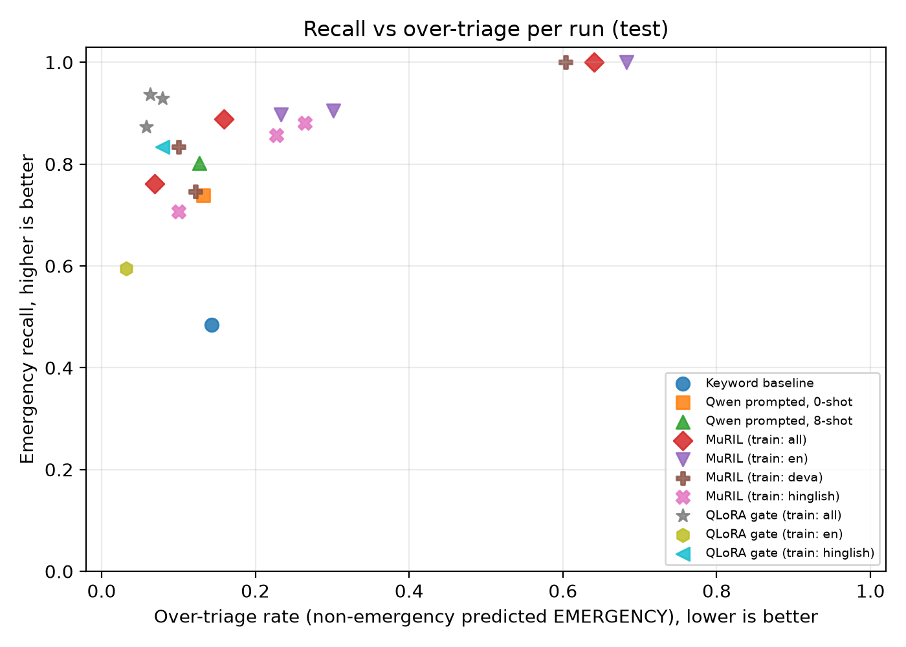
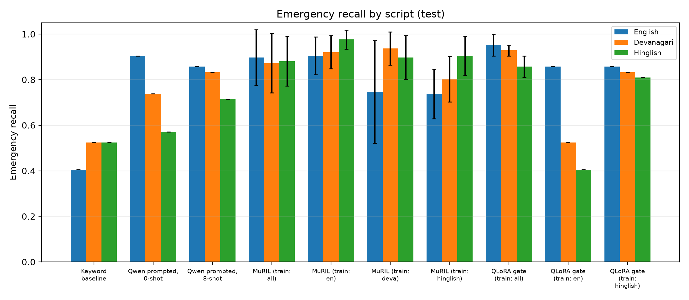

# Swasthya Saathi

A safety-gated, Hindi-first clinic front-desk agent for appointments and urgency triage. Patients write in Devanagari Hindi, romanised Hindi (Hinglish) or English. The project separates two decisions from language generation:

- a small fine-tuned **safety gate** decides how urgent a message is (`EMERGENCY`, `URGENT`, `ROUTINE`, `INSUFFICIENT`);
- a deterministic **action guard** approves state-changing tool calls (booking, rescheduling, cancelling), while the language model only coordinates the dialogue.

This is a research prototype built on synthetic data. It is not a medical device and gives no diagnosis, medicine or dose.

```
patient message -> normaliser -> safety gate --unsafe--> fixed reply + staff hand-off
                                     | safe
                                     v
                          orchestrator (LLM + state) -> action guard -> clinic tools
```

## Status

| Component | State |
|---|---|
| D3 script-parallel triage dataset (evaluation + training) | done |
| Triage systems: keyword (B0), MuRIL (B1), prompted Qwen (V0), QLoRA gate (G1) | done |
| Evaluation harness, scoring, tables, matched over-triage analysis (H1) | done |
| Training-script and prompting ablations | done |
| D4 clinic simulator, four tools, action guard, orchestrator | not started |
| 2x2 ablation of gate and guard against a single-prompt agent | not started |
| Clinician review of rubric and emergency templates | not started |

## Repository layout

```
.
├── configs/                  default settings (seeds, labels, scripts)
├── data/
│   ├── d3_triage/
│   │   ├── human_cases/      d3_cases.csv (evaluation), d3_train.csv (training), template.csv, archive/
│   │   └── rendered/         d3_dev.jsonl, d3_test.jsonl, d3_train.jsonl (one line per rendering)
│   └── d4_clinic/            clinic simulator scenarios (empty for now)
├── docs/                     writing guide, Kaggle runbook, workflow, experiment log, progress log
├── kaggle/                   standalone GPU scripts that run on Kaggle
├── outputs/
│   ├── raw/                  downloaded Kaggle outputs (not tracked by git)
│   ├── results/              per-run metric JSON, summary.csv, tables, logs
│   ├── figures/              plots made by make_tables.py
│   └── archive/              superseded or discarded runs, kept as evidence
├── report/                   LaTeX report
├── scripts/                  command-line tools (validate, score, tables, analysis)
│   └── bootstrap/            one-off installers that created the repository files
├── src/swasthya/             shared library
└── tests/                    unit tests (14)
```

## Setup

```bash
python -m venv .venv && source .venv/bin/activate
pip install -r requirements.txt pytest
export PYTHONPATH=src
pytest -q                     # 14 tests
```

GPU work (training and inference of MuRIL and Qwen) runs on Kaggle, not locally; `torch`, `transformers`, `peft`, `bitsandbytes` and `accelerate` are installed there (see `docs/KAGGLE_RUNBOOK.md`).

## Data: D3 script-parallel triage set

Every case is one imaginary patient message written three times, in English (`en`), Devanagari Hindi (`deva`) and Hinglish (`hinglish`), so that all three carry exactly the same clinical cues. A cue list (`cues` column) is written first and each rendering must contain those cues and nothing else.

| File | Cases | Renderings | Purpose |
|---|---|---|---|
| `human_cases/d3_cases.csv` | 150 | 450 | evaluation: dev (45 cases) and test (105 cases) |
| `human_cases/d3_train.csv` | 300 | 900 | training |

Labels (evaluation): EMERGENCY 60, URGENT 36, ROUTINE 30, INSUFFICIENT 24, with 24 minimal pairs (two cases that differ in one clinical cue that flips the label). Training: EMERGENCY 120, URGENT 75, ROUTINE 60, INSUFFICIENT 45.

CSV columns: `case_id, category, label, age, sex, cues, en, deva, hinglish, pair_id, notes, a2_present_en, a2_present_deva, a2_present_hinglish, a2_extra`. The `a2_*` columns hold a second annotator's cue-parity check. Seven categories: airway/breathing/consciousness, heart/brain, bleeding/injury/poisoning, maternal, newborn/child, general medical, mental-health crisis. The full writing rules and label rubric are in `docs/D3_GUIDE.md`.

Quality checks:
- **Parity:** 143 of 150 rows matched the cue list on the first pass; the 7 mismatches were adjudicated (original file in `human_cases/archive/`).
- **Overlap:** character 5-gram similarity between training and evaluation text has mean 0.156 and maximum 0.415 (no near-copies).
- **Splits:** by case, stratified on whether a case is an emergency, with minimal pairs kept together (seed 13).

## Systems and experiments

| ID | System | Notes |
|---|---|---|
| B0 | Keyword lexicon | English, Devanagari and Hinglish terms, priority rule, no negation handling |
| B1 | MuRIL (`google/muril-base-cased`) | fine-tuned classifier, 10 epochs, lr 5e-5, batch 8, seeds 13/42/2026 |
| V0 | Qwen2.5-3B-Instruct, 4-bit, prompted | zero-shot and 8-shot (2 per label from the training set) |
| G1 | Qwen2.5-3B-Instruct + QLoRA | rank 16, 3 epochs, lr 2e-4, seeds 13/42/2026 |

V0 and G1 use the same read-out: the model answers with one letter (A-D), and the logits of those four letters at the answer position become the class probabilities. The prompt and rubric are in `src/swasthya/prompts.py`.

Ablations: models trained on one script only (English, Devanagari or Hinglish) versus all three; zero-shot versus 8-shot prompting.

**Metrics** (`src/swasthya/metrics.py`):
- *emergency recall* (primary): share of EMERGENCY renderings predicted EMERGENCY;
- *over-triage*: share of non-emergencies predicted EMERGENCY; *under-triage*: share of urgent/emergency cases predicted less severe;
- *macro-F1* over the four labels; *ECE* when probabilities are available;
- *cross-script gap*: highest minus lowest emergency recall across the three scripts; *minimal-pair flip accuracy*;
- 95% confidence intervals from a bootstrap over **cases** (the three renderings of a case are resampled together).

Emergency recall is always read together with over-triage and macro-F1, because a model that predicts EMERGENCY for everything has perfect recall.

## Results (test split)

126 emergency renderings (42 cases per script). Mean ± sd over seeds; prompted systems are deterministic (one run).

| System | Runs | Emergency recall | Over-triage | Under-triage | Macro-F1 | Script gap |
|---|---|---|---|---|---|---|
| B0 keyword | 1 | 0.484 | 0.143 | 0.415 | 0.450 | 0.119 |
| V0 Qwen, zero-shot | 1 | 0.738 | 0.132 | 0.236 | 0.547 | 0.333 |
| V0 Qwen, 8-shot | 1 | 0.802 | 0.127 | 0.231 | 0.691 | 0.143 |
| B1 MuRIL, all scripts | 3 | 0.884 ± 0.119 | 0.289 ± 0.307 | 0.077 ± 0.080 | 0.630 ± 0.120 | 0.040 ± 0.036 |
| **G1 QLoRA gate, all scripts** | 3 | **0.913 ± 0.035** | **0.067 ± 0.011** | 0.065 ± 0.029 | **0.812 ± 0.037** | 0.095 ± 0.048 |

**H1: emergency recall at a fixed over-triage budget** (threshold chosen on dev, applied to test):

| System | Budget 5% | Budget 10% | Budget 20% |
|---|---|---|---|
| MuRIL, all scripts | 0.278 ± 0.290 | 0.476 ± 0.414 | 0.550 ± 0.443 |
| V0 Qwen, zero-shot | 0.421 | 0.508 | 0.754 |
| V0 Qwen, 8-shot | 0.508 | 0.627 | 0.754 |
| **G1 QLoRA gate** | **0.704 ± 0.097** | **0.820 ± 0.030** | **0.926 ± 0.046** |

At the 10% budget G1 beats the 8-shot gate by +0.16 to +0.21 and the zero-shot gate by +0.28 to +0.33 emergency recall (paired bootstrap over cases; all intervals exclude zero).

**Training-script ablation** (emergency recall in English / Devanagari / Hinglish):

| Model | Trained on | Emergency recall | Macro-F1 | EN / DE / HI recall |
|---|---|---|---|---|
| G1 QLoRA | all (3 seeds) | 0.913 ± 0.035 | 0.812 ± 0.037 | 0.952 / 0.929 / 0.857 |
| G1 QLoRA | English only (1 seed) | 0.595 | 0.717 | 0.857 / 0.524 / 0.405 |
| G1 QLoRA | Hinglish only (1 seed) | 0.833 | 0.795 | 0.857 / 0.833 / 0.809 |

Per-run numbers are in `outputs/results/summary.csv`; the full tables are generated into `outputs/results/table_test.md`.




Things to keep in mind when reading these numbers:
- Single runs on a GPU with a 4-bit model are not bit-exact: the same seed gave macro-F1 0.810 and 0.850 in two runs (the first is archived).
- One of three MuRIL seeds barely trained; this is why seeds are averaged and never cherry-picked.
- The 10% budget was chosen after earlier results were seen; the 5% and 20% budgets point the same way.
- All-script models see three times the data of single-script models, so the ablation mixes script coverage with data quantity.
- Early stopping and calibration are not applied yet. The rubric has not been reviewed by a clinician.

## How to reproduce

**1. Datasets (local)**
```bash
python scripts/validate_d3.py --export    # validate d3_cases.csv, write dev/test jsonl
python scripts/prepare_train.py           # validate d3_train.csv, overlap check, write train jsonl
python scripts/make_kaggle_bundle.py      # kaggle_bundle/swasthya-data.zip
```

**2. GPU runs (Kaggle)**: upload the bundle as a dataset, attach it to a notebook with a T4 GPU and internet on, and follow `docs/KAGGLE_RUNBOOK.md`. Examples:
```bash
python kaggle/run_muril.py --train_scripts all en deva hinglish --seeds 13 42 2026 --epochs 10 --lr 5e-5 --bs 8 --name muril_e10
python kaggle/run_llm_prompted.py --shots 8 --name v0_fewshot8
python kaggle/run_qlora_gate.py --train_scripts all --seed 13 --name qlora
```
Each script has a `--smoke` flag that runs a tiny version first, to check the environment.

**3. Scoring (local)**: copy the downloaded run folders into `outputs/raw/`, then
```bash
python scripts/score_all.py --boot 1000         # per-run JSON + outputs/results/summary.csv
python scripts/make_tables.py                   # mean ± sd tables and figures
python scripts/h1_matched_overtriage.py         # recall at a fixed over-triage budget
```
`score_all.py --splits dev` scores dev only, which is what to use while tuning, so the test split stays untouched.

## What each file does

### `src/swasthya/`
| Module | Purpose |
|---|---|
| `schema.py` | labels, scripts, categories, case specification |
| `metrics.py` | emergency recall, over/under-triage, macro-F1, ECE, case-level bootstrap, cross-script gap |
| `d3.py` | load and validate the D3 CSVs, parity report, group-aware dev/test split, jsonl export |
| `keyword_baseline.py` | baseline B0 (lexicon and text normalisation) |
| `evaluate.py` | scores any prediction file against gold; per-script results and minimal-pair statistics |
| `prompts.py` | system prompt, few-shot selection, letter read-out used by V0 and G1 |
| `kio.py` | small jsonl helpers shared by the GPU scripts and local scoring |

### `scripts/`
| Script | Purpose |
|---|---|
| `validate_d3.py` | validate `d3_cases.csv`, report parity, `--export` writes dev/test jsonl |
| `prepare_train.py` | validate `d3_train.csv`, compare with dev/test text, export train jsonl |
| `make_kaggle_bundle.py` | zip code and data for upload to Kaggle |
| `eval_triage.py` | score one system on one split (also runs the keyword baseline) |
| `score_all.py` | score every run in `outputs/raw/` and write `summary.csv` |
| `make_tables.py` | aggregate seeds into tables and draw the two figures |
| `h1_matched_overtriage.py` | recall at a fixed over-triage budget with paired intervals |
| `parity_fails.py`, `fix_parity_rows.py` | list and adjudicate rows that failed the second-annotator check |
| `strip_hints.py` | remove console hint lines from the scripts (dry run by default) |
| `bootstrap/` | one-off installers that generated the repository files |

### `kaggle/` (run on a GPU)
| Script | Purpose |
|---|---|
| `run_muril.py` | B1: fine-tune MuRIL, one run per training-script setting and seed |
| `run_llm_prompted.py` | V0: prompted Qwen, zero-shot or few-shot |
| `run_qlora_gate.py` | G1: QLoRA fine-tuning of Qwen as a four-way gate |

Every run folder holds `preds_dev.jsonl`, `preds_test.jsonl` (with class probabilities), `config.json` and, for trained models, `log.json`.

## Conventions

- Seeds: 13, 42, 2026. Hyperparameters are tuned on dev only.
- Superseded or discarded runs are moved to `outputs/archive/`, never deleted.
- `outputs/raw/` (large downloads) is not tracked; small result files in `outputs/results/` are.
- Prediction files: one JSON line per rendering, `{"id": "<case>|<script>", "pred": "EMERGENCY", "probs": [p_E, p_U, p_R, p_I]}`.